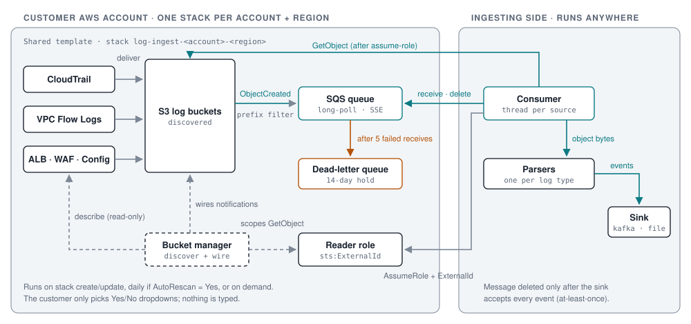
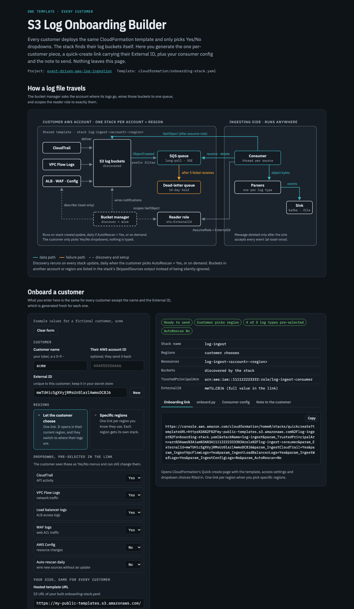

# Event-Driven AWS Log Ingestion & Self-Service Onboarding

Pull CloudTrail, VPC Flow Logs, ALB, WAF and AWS Config logs out of any number of AWS
accounts, **the moment each file lands in S3**. Every customer uses **the same
CloudFormation template**: they pick log types from dropdowns, and the stack finds the
buckets itself.



**How it works**

1. You host one template. Each customer gets a **quick-create link** that carries only
   their unique ExternalId.
2. They open it, pick **Yes/No dropdowns** (CloudTrail, VPC Flow Logs, load balancer,
   WAF, Config, and whether to auto-rescan daily) and click **Create**. There's nothing
   to type.
3. The stack's **bucket-manager Lambda** asks the account where those logs go, using
   read-only describe calls. It wires every bucket it finds (prefixes and KMS keys
   included) to **one SQS queue**, and lets a **reader role** read exactly those buckets.
4. The **consumer** (a container you run anywhere) assumes that role with the
   ExternalId, drains the queue, detects each file's log type from AWS's standard key
   layout, and hands events to a **sink** (Kafka, a file or stdout).
5. New log sources are picked up by a daily rescan (if the customer chose Yes), a stack
   Update, or a one-line `RescanNow` command.

### What the customer chooses and what's automatic

| Value | Where it comes from |
|---|---|
| Log types to share, auto-rescan, access mode | **Dropdowns** in the CloudFormation console |
| Region | Whatever region the customer deploys in |
| Resource names | Built from the account ID and region, e.g. `log-ingest-123456789012-us-east-1` |
| Buckets, prefixes, KMS keys | **Discovered** from CloudTrail, EC2, ELB, WAF, Config and S3 encryption settings |
| Your consumer's principal | Baked into the hosted template, the same for everyone |
| ExternalId | **Per customer**, generated by `tools/onboard.py` and carried in the link |
| Parser per file | Detected from AWS's key layout (`/CloudTrail/`, `/vpcflowlogs/`, ...) |

## Onboarding builder

A single-page tool in [`docs/onboarding-builder/index.html`](docs/onboarding-builder/index.html),
the browser version of `tools/onboard.py`. Enter a customer name, let them choose the
region or tick the regions they use, choose which dropdowns to pre-select, and it
generates the quick-create link (one per region) with a fresh ExternalId, the matching `onboard.py` command, the consumer config entry and a
ready-to-send note. It runs entirely in your browser: open the file locally, nothing is
sent anywhere.



## Why event-driven instead of polling

| | Polling the CloudWatch Logs API or listing buckets | S3 → SQS events (this project) |
|---|---|---|
| Latency | Minutes (poll interval) | Seconds after the file lands |
| Cost at scale | Grows with bucket size (repeated LIST calls) | Grows with new files only |
| Rate limits | API throttling per log group | Doesn't apply |
| Failure handling | Custom cursors and state files | Visibility timeout, retries, dead-letter queue |
| Adding a source | New poller per log group or bucket | Edit one stack parameter |

## Quick start

**1. Build and host the template once** with your consumer's role ARN baked in:
```bash
python3 tools/build_template.py \
  --trusted-principal arn:aws:iam::111122223333:role/log-ingest-consumer \
  --out dist/onboarding-stack.yaml
aws s3 cp dist/onboarding-stack.yaml s3://my-public-templates/log-ingest/onboarding-stack.yaml
```
The file holds no secrets, so it can be public-read (quick-create links need that).

**2. For each customer, generate their link:**
```bash
python3 tools/onboard.py --tenant acme \
  --trusted-principal arn:aws:iam::111122223333:role/log-ingest-consumer \
  --template-url https://my-public-templates.s3.amazonaws.com/log-ingest/onboarding-stack.yaml
```
It prints the link, a new ExternalId to keep in your secret store, and the consumer
config entry. With no `--region`, the link opens in whatever region the customer is
using, and they switch to where their logs are. If you know their regions, pass
`--region us-east-1,eu-west-1` for one link per region (each region needs its own stack;
all of them share the customer's one ExternalId). Send the link with the [customer guide](docs/ONBOARDING.md).

**3. The customer** clicks the link, picks the dropdowns and clicks Create. They reply
with the **AccountId** and **Region** from the Outputs tab.

**4. Run the consumer:**
```bash
cp config/sources.example.yaml config/sources.yaml     # add the customer's entry
export EXTERNAL_ID_ACME=...                              # from step 2
docker build -t log-ingest consumer/
docker run --rm -v "$PWD/config:/config" -e EXTERNAL_ID_ACME log-ingest
```

## Repository layout

| Path | What it is |
|---|---|
| `cloudformation/onboarding-stack.yaml` | **The shared template every customer deploys** (generated, don't edit) |
| `cloudformation/onboarding-stack.src.yaml` | Template source, with a placeholder where the Lambda is embedded |
| `lambda/bucket_manager.py` | Discovers log buckets, wires notifications, scopes the reader policy. Runs on stack events, daily, or on demand |
| `consumer/log_ingest/` | Consumer: supervisor, per-source workers, parsers, sinks, role assumption |
| `consumer/Dockerfile` | Non-root container image for the consumer |
| `config/sources.example.yaml` | Consumer config: tenant, account ID, region and ExternalId per stack |
| `tools/discover_log_sources.py` | Preview, from your laptop, what the stack will discover in an account |
| `tools/onboard.py` | Per-customer quick-create link, ExternalId and consumer config entry |
| `tools/build_template.py` | Embeds the Lambda into the template and bakes in your consumer principal |
| `docs/onboarding-builder/` | Browser-only onboarding builder page (open `index.html`) |
| `tests/` | 56 tests against a simulated AWS account (moto), including the code embedded in the template |
| `docs/` | [Architecture](docs/ARCHITECTURE.md) · [Onboarding](docs/ONBOARDING.md) · [Log sources](docs/LOG-SOURCES.md) · [Operations](docs/OPERATIONS.md) |

## Design highlights

- **One template for everyone.** The only per-customer value is the ExternalId, and it
  travels in the link. The template itself is identical for every customer.
- **Discovery, not data entry.** Buckets, prefixes and KMS keys come from the account's
  own configuration. That removes the most common onboarding mistake: a mistyped bucket
  or prefix.
- **Honest about what it can't reach.** A log destination in another account or region
  isn't silently ignored. The stack's `SkippedSources` output names it and says where
  to deploy.
- **Least privilege, no long-lived secrets.** The default is a cross-account role with an
  ExternalId. The reader can only `GetObject` on the discovered buckets and prefixes,
  and only consume its own queue. An access-key mode exists for consumers outside AWS;
  the key goes to Secrets Manager, never to stack outputs.
- **Plays well with existing setups.** Only notification entries whose ID starts with the
  stack's name are touched, so other notifications on the same bucket are kept.
- **No hidden state.** The reader policy is the record of what's wired, so a scheduled
  rescan knows what to unwire without a database.
- **At-least-once delivery.** A message is deleted only after the sink accepts every
  event. Failures retry, then land in a dead-letter queue that holds them for 14 days.
- **The code AWS runs is the code that's tested.** The Lambda is embedded in the template
  as-is, and every Lambda test also runs against that embedded copy.

## Development

```bash
python3 -m venv .venv && . .venv/bin/activate
pip install -r requirements-dev.txt
python tools/build_template.py          # after editing lambda/ or the .src template
cfn-lint cloudformation/onboarding-stack.yaml
pytest -q
```
CI runs all three on every push.

## License

MIT, see [LICENSE](LICENSE).
