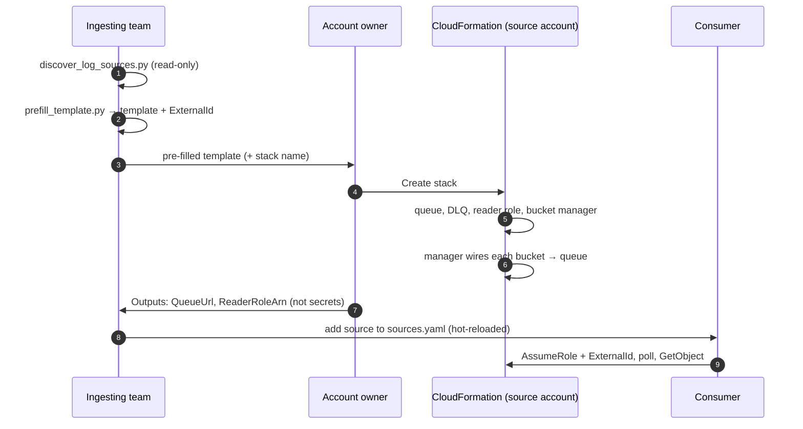
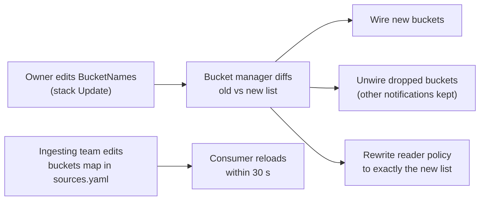

# Architecture

## Components

| Component | Lives in | Created by | Job |
|---|---|---|---|
| S3 log buckets | Source account | Already exist | Where AWS services deliver logs |
| Ingest queue + DLQ | Source account | Stack | One queue per stack. Every event carries its bucket name, so one queue serves them all |
| Queue policy | Source account | Stack | Lets S3 **from this account only** send to the queue. Denies non-TLS access |
| Bucket manager | Source account | Stack | Custom-resource Lambda. On every Create/Update/Delete it reconciles notifications and the reader's policy |
| Reader role (or user) | Source account | Stack | Trusts the ingesting principal with an ExternalId. Consumes the queue and reads only the listed buckets |
| Consumer | Anywhere | You | Assumes the reader role, drains the queue, parses, writes to the sink |

## Onboarding sequence

## Changing the bucket list

The two lists describe the same thing from both sides of the account boundary. A bucket
wired on the AWS side but missing from the consumer's config isn't dropped: the consumer
logs a warning and leaves the message, so it retries and ends up in the DLQ if nobody
acts. Nothing is lost silently.

## Decisions and trade-offs

**One stack per source account and region.** S3 can only notify an SQS queue in its own
region. A bucket owner can only wire their own buckets. So a source whose buckets span
two accounts or two regions gets two stacks. In the consumer config they share a
`tenant` and have different `name`s.

**No automatic discovery of new buckets.** AWS has no event for "a bucket started
receiving logs". Doing that automatically would mean standing permission to reconfigure
the source account, which is a much bigger trust ask. Adding a bucket stays a one-field
stack Update, run by the owner.

**Inline Lambda.** The manager ships inside the template, so the owner uploads one file
and needs no artifact bucket. CloudFormation limits inline code to 4,096 characters.
`build_template.py` strips comments and docstrings and shrinks indentation to fit, and
the tests run that exact minified code.

**The manager's S3 permission is `arn:aws:s3:::*`,** limited to
`Get/PutBucketNotification`. The bucket list is a parameter that changes over time, so
the resource can't be narrowed statically. The reader role, which is what the ingesting
side actually holds, is scoped exactly.

**Notification overlap.** S3 rejects two notifications for the same event type with
overlapping prefixes. If a bucket already sends `ObjectCreated` for an overlapping prefix
elsewhere, the stack fails with S3's error. The fix is to narrow one prefix, or fan out
through EventBridge or SNS.

**At-least-once, not exactly-once.** A crash after the sink accepts a batch, but before
the delete, redelivers that object. Downstream systems should de-duplicate on
`(s3.bucket, s3.key)` plus event position, or on a natural event ID such as
CloudTrail's `eventID`.
