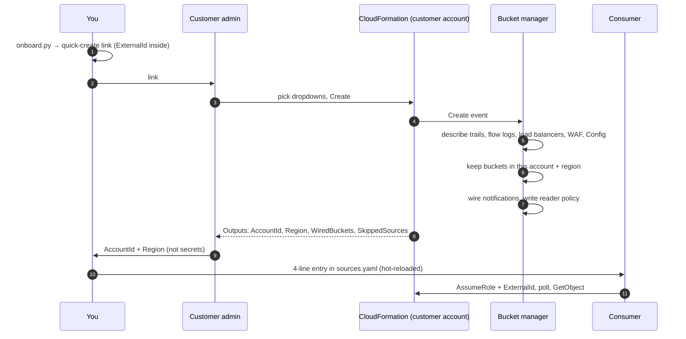
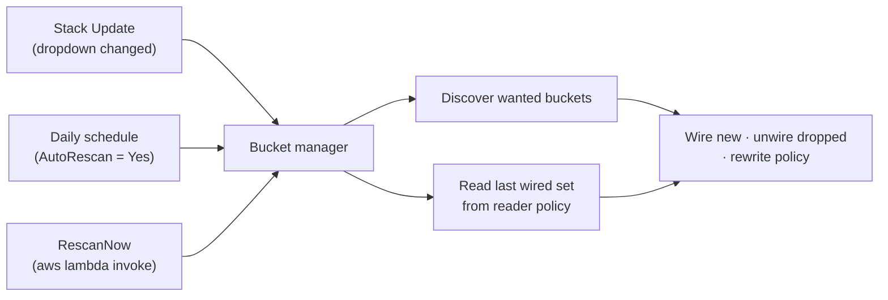

# Architecture

## Components

| Component | Lives in | Created by | Job |
|---|---|---|---|
| S3 log buckets | Customer account | Already exist | Where AWS services deliver logs |
| Ingest queue + DLQ | Customer account | Stack | One queue per account and region. Every event carries its bucket name, so one queue serves them all |
| Queue policy | Customer account | Stack | Lets S3 **from this account only** send to the queue. Denies non-TLS access |
| Bucket manager | Customer account | Stack | Lambda. Discovers log destinations, wires notifications, scopes the reader policy. Runs on stack events, daily (optional), or on demand |
| Reader role (or user) | Customer account | Stack | Trusts your consumer's principal with an ExternalId. Consumes the queue and reads only discovered buckets |
| Consumer | Anywhere | You | Assumes the reader role, drains the queue, detects log types, writes to the sink |

## Onboarding sequence

## How the bucket list stays current

On the consumer side nothing needs to change when buckets change: with `buckets: auto`
it detects each object's log type from the key (`/CloudTrail/`, `/vpcflowlogs/`,
`/elasticloadbalancing/`, `/WAFLogs/`, `/Config/`). An object it can't classify isn't
guessed: it's left on the queue, retries, and lands in the DLQ with a warning naming the
key.

## Decisions and trade-offs

**One shared template, one per-customer secret.** The ExternalId is what stops customer A
from giving you customer B's role ARN and having you read B's data (the "confused deputy"
problem). So it has to be unique per customer and chosen by you, not by the customer.
Everything else is identical, so it lives in one hosted template. The ExternalId rides in
the quick-create link and is `NoEcho` in the console.

**Names come from account and region.** `log-ingest-<account>-<region>` is unique without
any input and lets the consumer derive the queue URL and role ARN, so the customer only
has to send two non-secret values back. The cost is one stack per account and region,
which S3 requires anyway: a bucket can only notify a queue in its own region.

**Discovery only wires what it can own.** The Lambda can change notifications only on
buckets in its own account and region. A trail writing to a central log-archive account
(normal with AWS Organizations and Control Tower) is reported in `SkippedSources`, and
the fix is to deploy the same template in that account. There, the Control Tower archive
bucket (`aws-controltower-logs-<account>-<region>`) is found by name, because the
organization trail itself isn't visible from the archive account.

**The archive bucket is watched whole.** It holds CloudTrail and Config under per-account
folders that an S3 prefix filter can't separate. The consumer tells them apart by key.

**Auto-rescan is the customer's choice.** Yes means new sources are wired within a day
with nobody involved. No means nothing in the account changes after deployment unless
the customer updates the stack or runs `RescanNow`. Both are reasonable, so it's a
dropdown.

**Inline Lambda, unminified.** The manager ships inside the template (CloudFormation
allows inline code up to 4 MB), so there's one file to host and no artifact bucket per
region. `build_template.py` embeds the source byte-for-byte, and the tests run that
embedded copy.

**Broad S3 resource on the manager, narrow on the reader.** The manager needs
`Get/PutBucketNotification`, `GetBucketLocation` and `GetEncryptionConfiguration` on
`arn:aws:s3:::*` because buckets are discovered at run time. It can't read objects. The
reader role, which is what the ingesting side actually holds, is scoped to the
discovered bucket and prefix list.

**Notification overlap.** S3 rejects two notifications for the same event type with
overlapping prefixes. The manager merges prefixes within its own entries (the whole
bucket wins, and a longer prefix under a shorter one is dropped). If a bucket already sends
`ObjectCreated` elsewhere for an overlapping prefix, the stack fails with S3's error.
The fix is to narrow one prefix, or fan out through EventBridge or SNS.

**At-least-once, not exactly-once.** A crash after the sink accepts a batch, but before the
delete, redelivers that object. De-duplicate downstream on `(s3.bucket, s3.key)` plus
event position, or on a natural ID such as CloudTrail's `eventID`.
